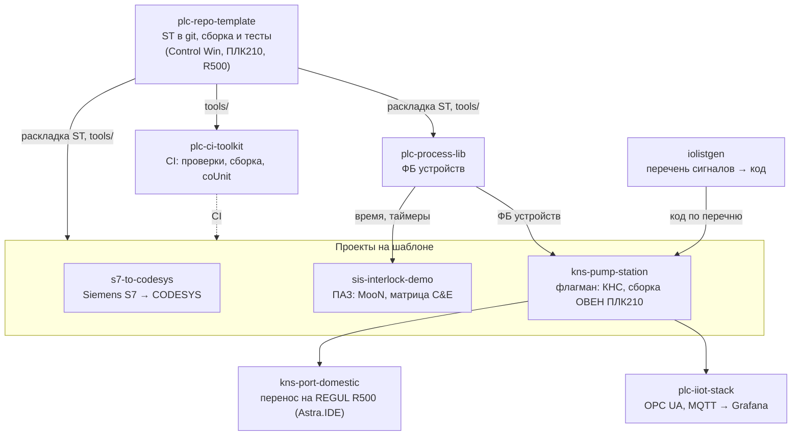

  <picture>
    <source media="(prefers-color-scheme: dark)" srcset="docs/media/banner-dark.svg">
    <source media="(prefers-color-scheme: light)" srcset="docs/media/banner-light.svg">
    
  </picture>

  
  
  
  
  
  
  

**Инженер АСУ ТП. Инструменты и практики для ПЛК ОВЕН и REGUL.** ОВЕН ПЛК210/СПК210 работают на CODESYS V3.5
SP17 Patch 3 — все актуальные прошивки по матрице ОВЕН привязаны к этой версии; REGUL R500 программируют в
Astra.IDE, OEM-сборке той же CODESYS 3.5.17. В обеих средах нет того, к чему привыкли в разработке ПО: CODESYS Git,
Static Analysis и Test Manager продаются в подписке Professional Developer Edition, а установщик и магазин
CODESYS с 2022 года из России недоступны. Отладку без железа ОВЕН официально не рекомендует, виртуальный ПЛК
REGUL работает 24 часа и только для некоммерческого использования.

Здесь — открытые проекты, которые закрывают эти пробелы: код ПЛК в git как текст, юнит-тесты и CI без лицензий,
библиотека ФБ устройств, генерация кода из перечня сигналов, флагманская насосная станция с испытаниями на
модели и сборкой под ОВЕН ПЛК210, перенос того же проекта на REGUL R500, логика ПАЗ и IIoT-стек. Каждое
утверждение в README проверено прогоном; что на ПЛК не загружалось — так и написано.

> **В работе — серия инструментов для ОВЕН и REGUL и программ миграции между средами** (CODESYS, Astra.IDE,
> ALTA IDE, Siemens S7). Новые репозитории появятся в этом профиле.

*Automation / PLC engineer: tools and practices for OWEN (PLC210/SPK210, CODESYS V3.5 SP17) and REGUL (R500,
Astra.IDE) PLCs — PLC code in git, unit tests and CI without CODESYS Professional Developer Edition, an OWEN
PLC210 target build generated from the I/O list, a REGUL port, IIoT. A series of OWEN/REGUL tools and migration
programs is in progress. Documentation is in Russian.*

## С чего начать

| Ваша задача на ОВЕН или REGUL | Где смотреть |
|---|---|
| Посмотреть подход на целом объекте: ТЗ, алгоритмы, код, модель объекта, автоматическая ПМИ и сборка под ПЛК210 | [kns-pump-station](https://github.com/kr0nsch/kns-pump-station) — флагман |
| Хранить проект CODESYS SP17 или Astra.IDE в git как текст, ревьюить в pull request, собирать и тестировать из консоли | [plc-repo-template](https://github.com/kr0nsch/plc-repo-template) — кнопка **Use this template** |
| Добавить в такие репозитории CI: проверки на каждый pull request, сборку и тесты в CODESYS после слияния | [plc-ci-toolkit](https://github.com/kr0nsch/plc-ci-toolkit) |
| Взять готовые ФБ устройств с единым обменом с HMI/SCADA, которые собираются и на ПЛК210, и на R500 | [plc-process-lib](https://github.com/kr0nsch/plc-process-lib) — `.compiled-library` в релизе |
| Получить код ПЛК, карту Modbus и теги SCADA из перечня сигналов, а не набирать их вручную | [iolistgen](https://github.com/kr0nsch/iolistgen) |
| Перевести проект с ОВЕН (CODESYS) на REGUL R500 (Astra.IDE) и заранее узнать цену переноса | [kns-port-domestic](https://github.com/kr0nsch/kns-port-domestic) |
| Перенести свой проект CODESYS (ОВЕН ПЛК2xx и др.) в Astra.IDE: импорт PLCopen XML, отчёт о ручной работе, замены библиотек ОВЕН, шаги импорта | [codesys-to-astra](https://github.com/kr0nsch/codesys-to-astra) — конвертер с веб-демо |
| Перевести проект CODESYS 2.3/3.5 на ALTA IDE (ОВЕН ПЛК1xx/ALTA): что не перенесётся, ограничения ALTA, черновик переноса | [alta-port](https://github.com/kr0nsch/alta-port) — анализатор и мигратор с веб-демо |
| Перенести проект CODESYS 3.5 в среду «Полигон» (ПЛК210-PL): что переносится, что придётся переписать, книга переноса | [codesys-to-polygon](https://github.com/kr0nsch/codesys-to-polygon) — анализатор и мигратор с веб-демо |
| Перевести программу Siemens S7 (SCL, LAD/FBD, STL, GRAPH) на ОВЕН ПЛК210 или REGUL и заранее оценить ручную работу | [s7-to-codesys](https://github.com/kr0nsch/s7-to-codesys) |
| Связать матрицу причин и следствий ПАЗ с кодом ПЛК, тестами и протоколом испытаний | [sis-interlock-demo](https://github.com/kr0nsch/sis-interlock-demo) |
| Вывести данные ПЛК в Grafana и принимать команды из внешней системы, не обходя защиты ПЛК | [plc-iiot-stack](https://github.com/kr0nsch/plc-iiot-stack) |

В README каждого репозитория — быстрый старт без ПЛК, пошаговое руководство `docs/USAGE.md`, что проверено и
какие есть ограничения.

## Проекты

| Репозиторий | Что это | Какую задачу инженера ОВЕН и REGUL решает |
|---|---|---|
| [kns-pump-station](https://github.com/kr0nsch/kns-pump-station) флагман | АСУ ТП вымышленной канализационной насосной станции КНС-1: три насоса с ПЧ по Modbus RTU, ступенчатое и ПИД-регулирование уровня, ротация и АВР, защиты, тревоги ISA-18.2, журнал событий, модель объекта с имитацией отказов, символы OPC UA; сборки для ОВЕН ПЛК210-14 и REGUL R500 61 | Логику станции на ПЛК210 обычно впервые видят на пусконаладке, а дерево устройств с модулями Mx210 и Modbus набирают руками в IDE. Здесь 39 проверок ПМИ выполняются автоматически на модели объекта, а сборку под ПЛК210 — дерево устройств, каналы Modbus RTU и TCP, привязки — одна команда строит из перечня сигналов: 0 ошибок |
| [plc-repo-template](https://github.com/kr0nsch/plc-repo-template) шаблон | Шаблон GitHub для проектов CODESYS V3.5: исходники ST в git, по файлу на объявление и тело каждого POU и метода. `cds.py` собирает из них проект — для Control Win, ПЛК210 или REGUL R500 — прогоняет юнит-тесты coUnit и выгружает правки из IDE обратно в текст | В CODESYS SP17 у ОВЕН и в Astra.IDE нет Git и командной разработки, а `.project` — бинарный файл: его нельзя ревьюить, сравнивать и сливать, сборку и тесты запускают вручную в IDE |
| [plc-process-lib](https://github.com/kr0nsch/plc-process-lib) библиотека | Библиотека ФБ: аналоговые и дискретные входы, двигатели прямого пуска и с ПЧ, задвижки, регулирующие клапаны, ПИД-регулятор, тревоги ISA-18.2, диагностика NAMUR NE 107; 453 теста coUnit, сборка на ПЛК210 и R500 61 | Блоки устройств пишут заново в каждом проекте, у каждого типа свои режимы и свой обмен с HMI, а проверить их без ПЛК нечем. Здесь режимы, безопасное состояние и формат команд для SCADA у всех устройств одинаковые и закреплены тестами |
| [plc-ci-toolkit](https://github.com/kr0nsch/plc-ci-toolkit) CI/CD | Переиспользуемые workflow GitHub Actions и хук pre-commit: линтер ST, статанализ iec_checker и RuSTy на Linux; Static Analysis Light, сборка и тесты coUnit в CODESYS на своём Windows-раннере | Полный статанализ и Test Manager CODESYS — в недоступной подписке, у ОВЕН нет ни одного документа про CI. Здесь замечания приходят аннотациями в pull request примерно через минуту, сборка и тесты идут после слияния в `main` |
| [iolistgen](https://github.com/kr0nsch/iolistgen) генератор | Генератор слоя устройств CODESYS из перечня сигналов (CSV/XLSX): проверка перечня, GVL и вызовы ФБ plc-process-lib, карты Modbus, теги SCADA, список тревог | Перечень сигналов ведут в Excel, а код ПЛК, карту обмена и базу тегов SCADA набирают по нему вручную; у REGUL генератора «перечень → проект» нет, интеграторы пишут свои. Здесь всё строится из одного перечня, ошибки видны до ПЛК |
| [kns-port-domestic](https://github.com/kr0nsch/kns-port-domestic) миграция на REGUL | Перенос флагмана КНС-1 и plc-process-lib из CODESYS 3.5.17.30 в Astra.IDE (REGUL R500): адаптированный код с пометками, полевой слой REGUL, чек-лист из 61 пункта, метрики цены переноса, журнал ошибок сборки | Переход на REGUL начинают вслепую: документация Astra.IDE не описывает наследование ФБ и десяток других конструкций, и непонятно, что соберётся. Здесь перенос измерен на реальном проекте: собрано без ошибок, что осталось проверить на ПЛК — по пунктам |
| [codesys-to-astra](https://github.com/kr0nsch/codesys-to-astra) миграция на REGUL | Конвертер проектов CODESYS 3.5 (все языки, IL → ST) в файл импорта Astra.IDE: профили ОВЕН и других вендоров, 26 правил совместимости, таблица замен библиотек ОВЕН, библиотека-прослойка AstraCompat, отчёт с трудоёмкостью и шагами ручного импорта; веб-демо в браузере | Переход с ОВЕН и других CODESYS-ПЛК на REGUL начинают без инструмента: что импортируется, что сломается и сколько работы — выясняют вручную. Здесь это видно до начала работ, а результат проверен реальной сборкой в Astra.IDE |
| [alta-port](https://github.com/kr0nsch/alta-port) миграция на ALTA IDE | Анализатор переносимости и мигратор CODESYS 2.3/3.5 → ALTA IDE: импорт .EXP и PLCopen XML, 48 правил по ограничениям ALTA, черновик переноса, профиль, уточнённый пробами на компиляторе ALTA 1.4.75; веб-демо в браузере | ALTA IDE молодая: только ST, без ООП, ACTION и METHOD, со своими лимитами, а проекты ПЛК1xx на CODESYS 2.3 переносятся вручную. Здесь до начала работ видно, что не перенесётся и почему, а часть переноса делается автоматически |
| [codesys-to-polygon](https://github.com/kr0nsch/codesys-to-polygon) миграция на «Полигон» | Перенос проектов CODESYS 3.5 в среду «Полигон»: разбор всех языков, 25 правил совместимости, графы зависимостей, перевод логики в C++ с библиотекой-прослойкой, книга переноса в Excel; поведение сверено с трассами рантайма CODESYS | Переход на «Полигон» означает смену языка и модели исполнения, а оценить объём работы заранее нечем. Здесь видно, что переносится автоматически и что вручную, а перенесённая логика проверена против записанного поведения исходного проекта |
| [s7-to-codesys](https://github.com/kr0nsch/s7-to-codesys) миграция с S7 | Конвертер программ Siemens S7 (TIA Portal) в CODESYS 3.5 для ОВЕН ПЛК210 и REGUL: SCL, LAD/FBD, STL (с таймерами и счётчиками S5), GRAPH → ST-двойник и SFC; DB → GVL, OB → задачи; отчёт о ручной работе, тесты поведения из сценариев CSV | Замена Siemens на отечественные ПЛК на CODESYS упирается в ручной перенос сотен блоков SCL, а молча потерянная семантика (`F_TRIG`, `RETAIN`, OB100) всплывает на пусконаладке. Конвертер помечает всё неоднозначное и считает объём ручной работы до начала проекта |
| [sis-interlock-demo](https://github.com/kr0nsch/sis-interlock-demo) ПАЗ | Демонстрация логики ПАЗ на ST (не SIL-система): голосование MooN с деградацией при отказе канала, матрица причин и следствий. Генератор `cemgen` строит из матрицы конфигурацию ПЛК, тесты, лист матрицы и протокол испытаний | Матрица живёт в Excel, а код ПЛК, тесты и протокол FAT пишут по ней вручную — после каждой ревизии они расходятся. Здесь всё генерируется из одной матрицы, CI падает при любом расхождении |
| [plc-iiot-stack](https://github.com/kr0nsch/plc-iiot-stack) IIoT | Стек данных насосной станции: OPC UA и MQTT → Telegraf → InfluxDB → Grafana, команды оператора обратно в ПЛК через белый список и проверку в ПЛК; эмулятор ПЛК для работы без железа | Данные ПЛК видны только в SCADA на объекте, а OwenCloud отдаёт их по API только опросом, не чаще 10 запросов за 10 секунд. Здесь открытый стек показывает их в Grafana, а команды из внешней системы не обходят защиты ПЛК |

## Как связаны проекты

Шаблон задаёт раскладку исходников ST в git и инструменты `tools/` (сборка, тесты, линтер); на них построены
библиотека, CI-тулкит и проекты объектов. Библиотека даёт проектам ФБ устройств и общий источник времени,
CI-тулкит — проверки и сборку в CODESYS для любого репозитория на шаблоне (s7-to-codesys и sis-interlock-demo
пока со своим `ci.yml`). Флагман собирается под ОВЕН ПЛК210 у себя (`targets/plc210`), а его перенос на REGUL с
полевым слоем REGUL — в kns-port-domestic.

## Общее для всех проектов

- **Исходники — текст.** Код ST лежит в git по файлу на объект, бинарный `.project` в репозиторий не попадает;
  проект собирается из текста скриптом — в CODESYS 3.5.17.30 или Astra.IDE 1.7.2.2.
- **Проверки без лицензии CODESYS.** Линтер ST, статанализ iec_checker, проверка компиляции RuSTy и pytest
  идут в CI на GitHub-hosted Linux на каждый push и pull request.
- **Тесты ST в настоящем CODESYS.** Юнит-тесты на coUnit (CfUnit) прогоняются из консоли в программном ПЛК
  CODESYS Control Win V3, итог — JUnit XML.
- **Целевые ПЛК — ОВЕН и REGUL.** Устройство проекта — переменными `CDS_DEVICE_*`: ОВЕН ПЛК210 (пакет таргетов
  OwenTargets 3.5.17.36 с ftp.owen.ru), REGUL R500 (Astra.IDE 1.7.2.2).
- **Честные границы.** В каждом README сказано, что проверено, а что — нет; ручные шаги в IDE описаны отдельно.
  Лицензия — MIT.

## Как проверено

Данные на 20.10.2026. Прогоны — CODESYS 3.5.17.30 (сборка с FTP ОВЕН) и CODESYS Control Win V3; сборки под целевые
ПЛК — с пакетом таргетов OwenTargets 3.5.17.36 (ОВЕН ПЛК210) и в Astra.IDE 1.7.2.2 (REGUL R500 61). **В ПЛК код
пока не загружался** — сборка под ПЛК означает компиляцию без ошибок. Протоколы — в разделе «Тесты и качество»
каждого README.

| Репозиторий | Тесты | Сборка под ОВЕН ПЛК210 и REGUL R500 |
|---|---|---|
| [kns-pump-station](https://github.com/kr0nsch/kns-pump-station#тесты-и-качество) | 342 из 342 тестов coUnit; ПМИ на имитаторе через OPC UA — 39 из 39 проверок соответствуют, пять — по автоматической части (протокол № 1, 19.10.2026) | ПЛК210-14 с деревом устройств из перечня (Modbus RTU и TCP, модули МВ210): сборка и генерация кода — 0 ошибок, 0 предупреждений; R500 61 — 0 ошибок |
| [plc-repo-template](https://github.com/kr0nsch/plc-repo-template#тесты-и-качество) | 18 из 18 тестов coUnit; цикл «импорт → экспорт» без диффа | ПЛК210 и R500 61 — 0 ошибок, 0 предупреждений |
| [plc-process-lib](https://github.com/kr0nsch/plc-process-lib#тесты-и-качество) | 453 из 453 тестов coUnit | ПЛК210 и R500 61 — 0 ошибок, 0 предупреждений |
| [plc-ci-toolkit](https://github.com/kr0nsch/plc-ci-toolkit#тесты-и-качество) | шаги Windows-задания локально: Static Analysis Light, 18 из 18 тестов coUnit, JUnit; на self-hosted раннере GitHub ещё не запускалось | пример: ПЛК210 и R500 61 — 0 ошибок |
| [sis-interlock-demo](https://github.com/kr0nsch/sis-interlock-demo#тесты-и-качество) | 255 из 255 тестов coUnit | ПЛК210 и R500 61 — 0 ошибок, 0 предупреждений |
| [iolistgen](https://github.com/kr0nsch/iolistgen#тесты-и-качество) | сгенерированный пример КНС-1 с plc-process-lib 1.0.0 — сборка 0 ошибок и 0 предупреждений; 4 из 4 тестов coUnit | тот же перечень строит дерево устройств ПЛК210 во флагмане |
| [kns-port-domestic](https://github.com/kr0nsch/kns-port-domestic#тесты-и-качество) | — | в Astra.IDE 1.7.2.2: библиотека и приложение с полевым слоем REGUL — 0 ошибок и 0 предупреждений на R500 61 и R500 71-W (сборки для ПЛК и ВПЛК, 19.10.2026) |
| [codesys-to-astra](https://github.com/kr0nsch/codesys-to-astra#тесты-и-проверки) | 688 тестов pytest; AstraCompat — 25 из 25 coUnit | 16 из 16 проверочных сборок в Astra.IDE 1.7.2.2 (R500 61) и CODESYS 3.5.17.30: матрица шести языков, цепочка S7 → CODESYS → Astra и образец SP18 — 0 ошибок |
| [alta-port](https://github.com/kr0nsch/alta-port#как-это-проверено) | 204 теста, 48 правил с корпусом примеров; на реальном проекте насосной станции 65 из 65 находок верные | компилятор ALTA IDE 1.4.75: перенесённый проект — 3 ошибки, все в местах, помеченных для ручного переноса; пробы языка — 30 из 32 |
| [codesys-to-polygon](https://github.com/kr0nsch/codesys-to-polygon#как-это-проверено) | 283 теста; перенесённая логика совпала с трассами рантайма CODESYS: 1557 из 1557 проверок, 7 блоков в C++11 и C++17 | корпус из 8 блоков на всех языках собран в CODESYS 3.5.17.30; в среде «Полигон» и на ПЛК не проверялось |
| [s7-to-codesys](https://github.com/kr0nsch/s7-to-codesys#тесты-и-качество) | 161 из 161 тестов coUnit в CODESYS 3.5.17.30; GRAPH, перенесённый в SFC, проходит тот же набор; эквивалентность с эталонной моделью — 7 блоков, сценарии и 500 случайных вызовов без расхождений | ПЛК210 и R500 — 0 ошибок (85 объектов), вариант SFC тоже собирается |
| [plc-iiot-stack](https://github.com/kr0nsch/plc-iiot-stack#тесты-и-качество) | 85 из 85 тестов coUnit ядра; во флагмане со встроенной частью ПЛК — 423 из 423; живой обмен OPC UA: 133 из 133 узлов Good, команды станции принимаются ПЛК | — |

---

Вопрос или замечание по проекту — откройте issue в его репозитории.
