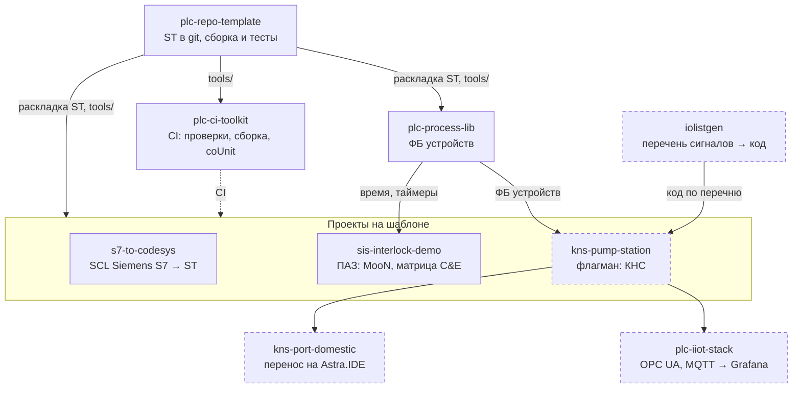

  <picture>
    <source media="(prefers-color-scheme: dark)" srcset="docs/media/banner-dark.svg">
    <source media="(prefers-color-scheme: light)" srcset="docs/media/banner-light.svg">
    
  </picture>

  
  
  
  
  
  

**Инженер АСУ ТП.** Пишу код ПЛК на CODESYS V3.5 (IEC 61131-3, Structured Text) так, чтобы его можно было
ревьюить в git, проверять юнит-тестами и собирать в CI, как обычное программное обеспечение.

Здесь — открытые проекты об этом: флагманская насосная станция с автоматической ПМИ, шаблон репозитория,
библиотека функциональных блоков, CI для ПЛК, генератор кода из перечня сигналов, миграция с Siemens S7,
перенос на отечественную Astra.IDE, логика ПАЗ и IIoT-стек.
Проекты — для программистов ПЛК и техлидов у интеграторов, машиностроителей и вендоров ПЛК, которым нужны
ревью, тесты и CI для кода CODESYS.

*Automation / PLC engineer: CODESYS V3.5, IEC 61131-3 Structured Text, unit-tested PLC code, CI for PLC
projects, migration from Siemens S7, IIoT. Documentation is in Russian.*

## С чего начать

| Ваша задача | Где смотреть |
|---|---|
| Посмотреть подход на целом объекте: ТЗ, алгоритмы, код, модель объекта и автоматическая ПМИ | [kns-pump-station](https://github.com/kr0nsch/kns-pump-station) — флагман |
| Хранить проект CODESYS в git как текст, ревьюить изменения в pull request, собирать и тестировать из консоли | [plc-repo-template](https://github.com/kr0nsch/plc-repo-template) — кнопка **Use this template** |
| Добавить в такие репозитории CI: проверки на каждый pull request, сборку и тесты в CODESYS после слияния | [plc-ci-toolkit](https://github.com/kr0nsch/plc-ci-toolkit) |
| Взять готовые ФБ устройств с единым обменом с HMI/SCADA вместо того, чтобы писать их под каждый объект | [plc-process-lib](https://github.com/kr0nsch/plc-process-lib) — `.compiled-library` в релизе |
| Оценить и выполнить перевод программы с Siemens S7 (SCL) на CODESYS | [s7-to-codesys](https://github.com/kr0nsch/s7-to-codesys) |
| Связать матрицу причин и следствий ПАЗ с кодом ПЛК, тестами и протоколом испытаний | [sis-interlock-demo](https://github.com/kr0nsch/sis-interlock-demo) |
| Получить код ПЛК, карту Modbus и теги SCADA из перечня сигналов, а не набирать их вручную | [iolistgen](https://github.com/kr0nsch/iolistgen) |
| Оценить и выполнить перенос проекта CODESYS на отечественную Astra.IDE (REGUL) | [kns-port-domestic](https://github.com/kr0nsch/kns-port-domestic) |
| Вывести данные ПЛК в Grafana и принимать команды из внешней системы, не обходя защиты ПЛК | [plc-iiot-stack](https://github.com/kr0nsch/plc-iiot-stack) |

В README каждого репозитория — быстрый старт без ПЛК, пошаговое руководство `docs/USAGE.md`, что проверено и
какие есть ограничения.

## Проекты

| Репозиторий | Что это | Какую задачу решает |
|---|---|---|
| [kns-pump-station](https://github.com/kr0nsch/kns-pump-station) флагман | АСУ ТП вымышленной канализационной насосной станции КНС-1: три насоса с ПЧ (Modbus), ступенчатое и ПИД-регулирование уровня, ротация и АВР, защиты, тревоги ISA-18.2, журнал событий, модель объекта с имитацией отказов, символы OPC UA | Показывает, как весь подход работает на целом объекте: от ТЗ, перечня сигналов и алгоритмов до кода на библиотеке, модели объекта и программы испытаний — 39 проверок ПМИ выполняются автоматически через OPC UA на имитаторе |
| [plc-repo-template](https://github.com/kr0nsch/plc-repo-template) шаблон | Шаблон GitHub для проектов CODESYS V3.5: исходники ST в git, по файлу на объявление и тело каждого POU и метода. `cds.py` собирает из них проект, прогоняет юнит-тесты coUnit и выгружает правки из IDE обратно в текст | Проект CODESYS (`.project`) — бинарный файл: в git его нельзя ревьюить, сравнивать и сливать, а сборку и тесты запускают вручную в IDE |
| [plc-process-lib](https://github.com/kr0nsch/plc-process-lib) библиотека | Библиотека ФБ: аналоговые и дискретные входы, двигатели прямого пуска и с ПЧ, задвижки, регулирующие клапаны, ПИД-регулятор, тревоги ISA-18.2, диагностика NAMUR NE 107 | Блоки устройств пишут заново в каждом проекте, и у каждого типа свои режимы и свой обмен с HMI. Здесь режимы, безопасное состояние и формат команд и состояний для SCADA у всех устройств одинаковые |
| [plc-ci-toolkit](https://github.com/kr0nsch/plc-ci-toolkit) CI/CD | Переиспользуемые workflow GitHub Actions и хук pre-commit: линтер ST, статанализ iec_checker и RuSTy на Linux; Static Analysis Light, сборка и тесты coUnit в CODESYS на своём Windows-раннере | Сборку и тесты проекта CODESYS запускают вручную в IDE, а pull request сливают без автоматических проверок. Здесь замечания приходят аннотациями в pull request примерно через минуту, сборка и тесты идут после слияния в `main` |
| [s7-to-codesys](https://github.com/kr0nsch/s7-to-codesys) миграция | Конвертер SCL (Siemens S7, TIA Portal) → ST CODESYS V3.5: имена и структура один к одному, DB → GVL, OB → задачи, отчёт о ручной работе, тесты поведения из сценариев CSV | SCL не компилируется в CODESYS как есть, перенос сотен блоков вручную долог, а молча потерянная семантика (`F_TRIG`, `RETAIN`, OB100) всплывает на пусконаладке. Конвертер помечает всё неоднозначное и считает объём ручной работы до начала проекта |
| [sis-interlock-demo](https://github.com/kr0nsch/sis-interlock-demo) ПАЗ | Демонстрация логики ПАЗ на ST (не SIL-система): голосование MooN с деградацией при отказе канала, матрица причин и следствий. Генератор `cemgen` строит из матрицы конфигурацию ПЛК, тесты, лист матрицы и протокол испытаний | Матрица живёт в Excel, а код ПЛК, тесты и протокол FAT пишут по ней вручную — после каждой ревизии они расходятся. Здесь всё генерируется из одной матрицы, CI падает при любом расхождении |
| [iolistgen](https://github.com/kr0nsch/iolistgen) генератор | Генератор слоя устройств CODESYS из перечня сигналов (CSV/XLSX): проверка перечня, GVL и вызовы ФБ plc-process-lib, карты Modbus, теги SCADA, список тревог | Перечень сигналов ведут в Excel, а код ПЛК, карту обмена и базу тегов SCADA набирают по нему вручную — с опечатками и расхождениями после каждой ревизии. Здесь всё генерируется из одного перечня, ошибки перечня видны до ПЛК |
| [kns-port-domestic](https://github.com/kr0nsch/kns-port-domestic) перенос | Перенос флагмана КНС-1 и plc-process-lib из CODESYS 3.5.17.30 в отечественную Astra.IDE (REGUL): адаптированный код с пометками, чек-лист из 61 пункта, метрики цены переноса, журнал ошибок сборки | Переход на отечественный ПЛК начинают вслепую: непонятно, что из кода CODESYS не соберётся и сколько это стоит. Здесь перенос измерен на реальном проекте: что совместимо, что пришлось менять и что ещё проверить на железе |
| [plc-iiot-stack](https://github.com/kr0nsch/plc-iiot-stack) IIoT | Стек данных насосной станции: OPC UA и MQTT → Telegraf → InfluxDB → Grafana, команды оператора обратно в ПЛК через белый список и проверку в ПЛК; эмулятор ПЛК для работы без железа | Данные ПЛК видны только в SCADA на объекте, а аналитика (наработка, пуски, тревоги по суткам) собирается вручную. Здесь открытый стек показывает их в Grafana, а команды из внешней системы не обходят защиты ПЛК |

## Как связаны проекты

Шаблон задаёт раскладку исходников ST в git и инструменты `tools/` (сборка, тесты, линтер); на них построены
библиотека, CI-тулкит и проекты объектов. Библиотека даёт проектам ФБ устройств и общий источник времени,
CI-тулкит — проверки и сборку в CODESYS для любого репозитория на шаблоне (s7-to-codesys и sis-interlock-demo
пока со своим `ci.yml`). Блоки с пунктирной рамкой — проекты, которые ещё не опубликованы.

## Общее для всех проектов

- **Исходники — текст.** Код ST лежит в git по файлу на объект, бинарный `.project` в репозиторий не попадает;
  проект CODESYS собирается из текста скриптом.
- **Проверки без лицензии CODESYS.** Линтер ST, статанализ iec_checker, проверка компиляции RuSTy и pytest
  идут в CI на GitHub-hosted Linux на каждый push и pull request.
- **Тесты ST в настоящем CODESYS.** Юнит-тесты на coUnit (CfUnit) прогоняются из консоли в программном ПЛК
  CODESYS Control Win V3, итог — JUnit XML.
- **Честные границы.** В каждом README сказано, что проверено в CODESYS, а что — нет; ручные шаги в IDE
  описаны отдельно.
- **Платформа:** CODESYS 3.5.17.30 (SP17 Patch 3), целевой ПЛК — ОВЕН ПЛК210. Лицензия — MIT.

## Как проверено

Данные на 19.10.2026. Прогоны — CODESYS 3.5.17.30 и CODESYS Control Win V3, для kns-port-domestic — сборка в Astra.IDE 1.7.2.2; **на ПЛК210 код пока не
запускался.** Протоколы — в разделе «Тесты и качество» каждого README.

| Репозиторий | Результат в CODESYS |
|---|---|
| [kns-pump-station](https://github.com/kr0nsch/kns-pump-station#тесты-и-качество) | 337 из 337 тестов coUnit; ПМИ на имитаторе через OPC UA — 39 из 39 проверок соответствуют, пять — по автоматической части (протокол № 1) |
| [plc-repo-template](https://github.com/kr0nsch/plc-repo-template#тесты-и-качество) | сборка и проверка всех объектов — 0 ошибок и 0 предупреждений; 18 из 18 тестов coUnit; цикл «импорт → экспорт» без диффа |
| [plc-process-lib](https://github.com/kr0nsch/plc-process-lib#тесты-и-качество) | 453 из 453 тестов coUnit |
| [plc-ci-toolkit](https://github.com/kr0nsch/plc-ci-toolkit#тесты-и-качество) | шаги Windows-задания локально: Static Analysis Light, 18 из 18 тестов coUnit, JUnit; на self-hosted раннере GitHub ещё не запускалось |
| [s7-to-codesys](https://github.com/kr0nsch/s7-to-codesys#тесты-и-качество) | демокорпус (20 файлов SCL) после конвертации — 0 ошибок и 0 предупреждений; 74 из 74 тестов coUnit |
| [sis-interlock-demo](https://github.com/kr0nsch/sis-interlock-demo#тесты-и-качество) | 255 из 255 тестов coUnit |
| [iolistgen](https://github.com/kr0nsch/iolistgen#тесты-и-качество) | сгенерированный пример КНС-1 с plc-process-lib 1.0.0 — сборка 0 ошибок и 0 предупреждений; 4 из 4 тестов coUnit |
| [kns-port-domestic](https://github.com/kr0nsch/kns-port-domestic#тесты-и-качество) | в Astra.IDE 1.7.2.2: библиотека и приложение — 0 ошибок и 0 предупреждений на REGUL R500 61 и R500 71-W (сборки для ПЛК и ВПЛК); на ПЛК не загружалось |
| [plc-iiot-stack](https://github.com/kr0nsch/plc-iiot-stack#тесты-и-качество) | 85 из 85 тестов coUnit ядра; во флагмане со встроенной частью ПЛК — 423 из 423; живой обмен OPC UA: 133 из 133 узлов Good, команды станции принимаются ПЛК |

---

Вопрос или замечание по проекту — откройте issue в его репозитории.
