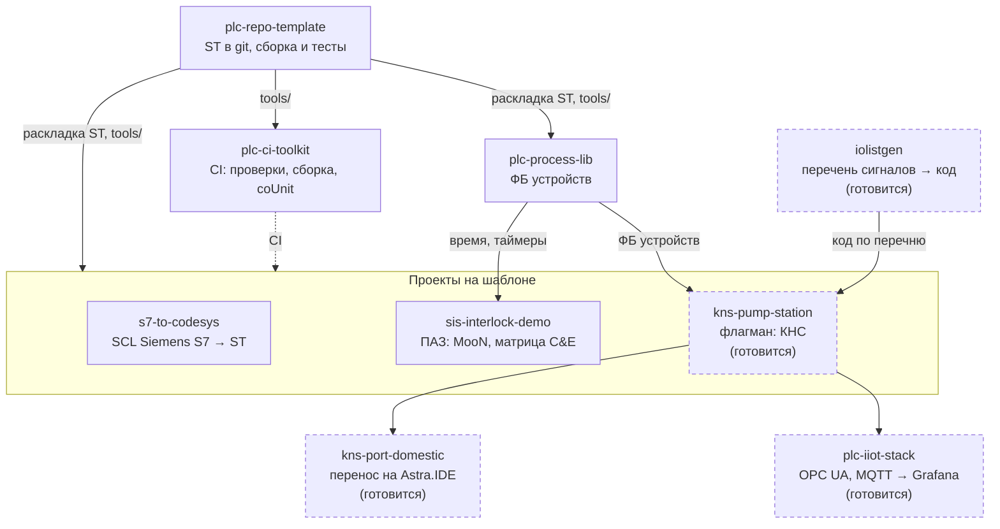

  <picture>
    <source media="(prefers-color-scheme: dark)" srcset="docs/media/banner-dark.svg">
    <source media="(prefers-color-scheme: light)" srcset="docs/media/banner-light.svg">
    
  </picture>

  
  
  
  
  
  

**Инженер АСУ ТП.** Пишу код ПЛК на CODESYS V3.5 (IEC 61131-3, Structured Text) так, чтобы его можно было
ревьюить в git, проверять юнит-тестами и собирать в CI, как обычное программное обеспечение.

Здесь — открытые проекты об этом: шаблон репозитория, библиотека функциональных блоков, CI для ПЛК, миграция
с Siemens S7 и логика ПАЗ; в работе — насосная станция, перенос на отечественную среду разработки и IIoT.
Проекты — для программистов ПЛК и техлидов у интеграторов, машиностроителей и вендоров ПЛК, которым нужны
ревью, тесты и CI для кода CODESYS.

*Automation / PLC engineer: CODESYS V3.5, IEC 61131-3 Structured Text, unit-tested PLC code, CI for PLC
projects, migration from Siemens S7, IIoT. Documentation is in Russian.*

## С чего начать

| Ваша задача | Где смотреть |
|---|---|
| Хранить проект CODESYS в git как текст, ревьюить изменения в pull request, собирать и тестировать из консоли | [plc-repo-template](https://github.com/kr0nsch/plc-repo-template) — кнопка **Use this template** |
| Добавить в такие репозитории CI: проверки на каждый pull request, сборку и тесты в CODESYS после слияния | [plc-ci-toolkit](https://github.com/kr0nsch/plc-ci-toolkit) |
| Взять готовые ФБ устройств с единым обменом с HMI/SCADA вместо того, чтобы писать их под каждый объект | [plc-process-lib](https://github.com/kr0nsch/plc-process-lib) — `.compiled-library` в релизе |
| Оценить и выполнить перевод программы с Siemens S7 (SCL) на CODESYS | [s7-to-codesys](https://github.com/kr0nsch/s7-to-codesys) |
| Связать матрицу причин и следствий ПАЗ с кодом ПЛК, тестами и протоколом испытаний | [sis-interlock-demo](https://github.com/kr0nsch/sis-interlock-demo) |

В README каждого репозитория — быстрый старт без ПЛК, пошаговое руководство `docs/USAGE.md`, что проверено и
какие есть ограничения.

## Проекты

| Репозиторий | Что это | Какую задачу решает |
|---|---|---|
| [plc-repo-template](https://github.com/kr0nsch/plc-repo-template) шаблон | Шаблон GitHub для проектов CODESYS V3.5: исходники ST в git, по файлу на объявление и тело каждого POU и метода. `cds.py` собирает из них проект, прогоняет юнит-тесты coUnit и выгружает правки из IDE обратно в текст | Проект CODESYS (`.project`) — бинарный файл: в git его нельзя ревьюить, сравнивать и сливать, а сборку и тесты запускают вручную в IDE |
| [plc-process-lib](https://github.com/kr0nsch/plc-process-lib) библиотека | Библиотека ФБ: аналоговые и дискретные входы, двигатели прямого пуска и с ПЧ, задвижки, регулирующие клапаны, ПИД-регулятор, тревоги ISA-18.2, диагностика NAMUR NE 107 | Блоки устройств пишут заново в каждом проекте, и у каждого типа свои режимы и свой обмен с HMI. Здесь режимы, безопасное состояние и формат команд и состояний для SCADA у всех устройств одинаковые |
| [plc-ci-toolkit](https://github.com/kr0nsch/plc-ci-toolkit) CI/CD | Переиспользуемые workflow GitHub Actions и хук pre-commit: линтер ST, статанализ iec_checker и RuSTy на Linux; Static Analysis Light, сборка и тесты coUnit в CODESYS на своём Windows-раннере | Сборку и тесты проекта CODESYS запускают вручную в IDE, а pull request сливают без автоматических проверок. Здесь замечания приходят аннотациями в pull request примерно через минуту, сборка и тесты идут после слияния в `main` |
| [s7-to-codesys](https://github.com/kr0nsch/s7-to-codesys) миграция | Конвертер SCL (Siemens S7, TIA Portal) → ST CODESYS V3.5: имена и структура один к одному, DB → GVL, OB → задачи, отчёт о ручной работе, тесты поведения из сценариев CSV | SCL не компилируется в CODESYS как есть, перенос сотен блоков вручную долог, а молча потерянная семантика (`F_TRIG`, `RETAIN`, OB100) всплывает на пусконаладке. Конвертер помечает всё неоднозначное и считает объём ручной работы до начала проекта |
| [sis-interlock-demo](https://github.com/kr0nsch/sis-interlock-demo) ПАЗ | Демонстрация логики ПАЗ на ST (не SIL-система): голосование MooN с деградацией при отказе канала, матрица причин и следствий. Генератор `cemgen` строит из матрицы конфигурацию ПЛК, тесты, лист матрицы и протокол испытаний | Матрица живёт в Excel, а код ПЛК, тесты и протокол FAT пишут по ней вручную — после каждой ревизии они расходятся. Здесь всё генерируется из одной матрицы, CI падает при любом расхождении |

## Как связаны проекты

Шаблон задаёт раскладку исходников ST в git и инструменты `tools/` (сборка, тесты, линтер); на них построены
библиотека, CI-тулкит и проекты объектов. Библиотека даёт проектам ФБ устройств и общий источник времени,
CI-тулкит — проверки и сборку в CODESYS для любого репозитория на шаблоне (s7-to-codesys и sis-interlock-demo
пока со своим `ci.yml`). Блоки с пунктирной рамкой — проекты, которые ещё не опубликованы.

## Готовится

| Проект | Что это | Статус |
|---|---|---|
| `kns-pump-station` | Флагман: канализационная насосная станция на три насоса с ПЧ (Modbus RTU) — алгоритм, модель объекта для испытаний без железа, HMI; на устройствах plc-process-lib | готовится |
| `kns-port-domestic` | Перенос флагмана и библиотеки из CODESYS в отечественную среду Astra.IDE с подсчётом цены переноса | готовится |
| `plc-iiot-stack` | IIoT-стенд: данные ПЛК по OPC UA и MQTT → InfluxDB → Grafana, команды оператора обратно с проверкой в ПЛК; работает и на эмуляторе без ПЛК | готовится |
| `iolistgen` | Генератор: перечень сигналов (Excel, CSV) → проверка → код ПЛК для plc-process-lib, карты обмена Modbus, импорт тегов SCADA | готовится |

## Общее для всех проектов

- **Исходники — текст.** Код ST лежит в git по файлу на объект, бинарный `.project` в репозиторий не попадает;
  проект CODESYS собирается из текста скриптом.
- **Проверки без лицензии CODESYS.** Линтер ST, статанализ iec_checker, проверка компиляции RuSTy и pytest
  идут в CI на GitHub-hosted Linux на каждый push и pull request.
- **Тесты ST в настоящем CODESYS.** Юнит-тесты на coUnit (CfUnit) прогоняются из консоли в программном ПЛК
  CODESYS Control Win V3, итог — JUnit XML.
- **Честные границы.** В каждом README сказано, что проверено в CODESYS, а что — нет; ручные шаги в IDE
  описаны отдельно.
- **Платформа:** CODESYS 3.5.17.30 (SP17 Patch 3), целевой ПЛК — ОВЕН ПЛК210. Лицензия — MIT.

## Как проверено

Данные на 19.10.2026. Все прогоны — CODESYS 3.5.17.30 и CODESYS Control Win V3; **на ПЛК210 код пока не
запускался.** Протоколы — в разделе «Тесты и качество» каждого README.

| Репозиторий | Результат в CODESYS |
|---|---|
| [plc-repo-template](https://github.com/kr0nsch/plc-repo-template#тесты-и-качество) | сборка и проверка всех объектов — 0 ошибок и 0 предупреждений; 18 из 18 тестов coUnit; цикл «импорт → экспорт» без диффа |
| [plc-process-lib](https://github.com/kr0nsch/plc-process-lib#тесты-и-качество) | 453 из 453 тестов coUnit |
| [plc-ci-toolkit](https://github.com/kr0nsch/plc-ci-toolkit#тесты-и-качество) | шаги Windows-задания локально: Static Analysis Light, 18 из 18 тестов coUnit, JUnit; на self-hosted раннере GitHub ещё не запускалось |
| [s7-to-codesys](https://github.com/kr0nsch/s7-to-codesys#тесты-и-качество) | демокорпус (20 файлов SCL) после конвертации — 0 ошибок и 0 предупреждений; 74 из 74 тестов coUnit |
| [sis-interlock-demo](https://github.com/kr0nsch/sis-interlock-demo#тесты-и-качество) | 255 из 255 тестов coUnit |

---

Вопрос или замечание по проекту — откройте issue в его репозитории.
